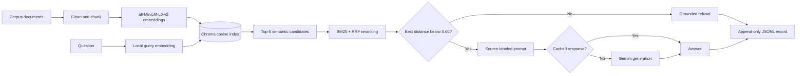

# The Unofficial Guide

An observable, source-grounded retrieval-augmented generation (RAG) system for
answering questions over a local knowledge base.

**Python · ChromaDB · all-MiniLM-L6-v2 · BM25/RRF · Gemini · Flask · JSONL**

The Unofficial Guide retrieves relevant campus documents, rejects unsupported
questions before they reach the language model, and generates concise answers
that name their sources. Every request produces structured operational data,
including stage latency, token usage, cache behavior, API attempts, retries,
and safe error details.

The application ingests an existing directory of text or Markdown documents,
cleans and chunks them, generates local embeddings, and builds a persistent
ChromaDB index. Users then query that indexed knowledge base through the CLI or
optional HTTP API. It is a document-ingestion and question-answering pipeline,
not a web crawler or document-upload interface.

## Why this project is interesting

Many RAG demos stop after returning a plausible answer. This project also asks:

- Was the retrieved context relevant enough to answer safely?
- Which source supported the response?
- How long did retrieval and generation take?
- How many tokens and API attempts did this request consume?
- Was the response cached, retried, refused, or unsuccessful?
- Can those claims be reproduced across independent evaluation trials?

The result is a compact RAG application that can be inspected and evaluated,
not just demonstrated.

## Example

```text
Question: What time does Halden Hall close?

Answer: Halden Hall closes at 7:00pm.
Source: dining_halden_hall.txt
```

An unrelated question such as `What is the capital of Mongolia?` is rejected
before Gemini is called:

```text
I don't have enough information about that.
```

## Architecture



The vector search determines the candidate set. BM25 and reciprocal rank
fusion then rerank those candidates so exact terms such as course numbers and
building names receive more weight without discarding semantic similarity.

## Engineering highlights

### Retrieval and grounding

- Preserves each short, topic-focused campus document as one complete chunk
  instead of splitting sentences across fixed character windows.
- Generates 384-dimensional embeddings locally with Chroma's ONNX build of
  `all-MiniLM-L6-v2` and stores them in a persistent cosine-distance index.
- Retrieves five semantic candidates and reranks them with BM25 and reciprocal
  rank fusion.
- Applies a measured cosine-distance gate (`0.60`) before generation and
  returns a deterministic refusal when the evidence is too weak.
- Sends Gemini only the retrieved excerpts and requires every generated answer
  to identify its source file.

### Reliability and observability

- Writes exactly one append-only JSONL record for each success, refusal, or
  error through the shared `ask_pipeline()` function used by both CLI and HTTP
  paths.
- Assigns UUID request and session identifiers and records retrieval,
  generation, and end-to-end latency using `time.perf_counter()`.
- Captures per-request prompt/output tokens, cache hits, API attempts, retry
  counts, measured retry waits, and local rate-limit waits without leaking
  metrics between concurrent request contexts.
- Sanitizes exception details in logs while re-raising the original application
  exception; logging failures are visible but do not replace successful answers
  or mask pipeline failures.
- Includes response caching, a session request budget, process-local rate
  limiting, and exponential backoff for provider rate-limit responses.

### Evaluation

- Defines five measurable acceptance criteria for logging completeness,
  latency, token/cache accuracy, safe failure records, and request/session IDs.
- Runs every criterion in three independent trials with isolated records and
  genuine Gemini responses where model output is required.
- Preserves machine-readable JSON, raw JSONL, and human-readable reports for
  both baseline and post-improvement evaluations.
- Uses deterministic mocks only for automated unit tests and explicitly labels
  the controlled retry comparison as simulated rather than live model evidence.

## Measured results

| Measurement | Result |
|---|---:|
| Automated instrumentation tests | **22 passed** |
| Baseline acceptance evaluation | **5/5 criteria passed** in all three trials |
| Scored warm uncached latency | **30/30 requests under 4 seconds** across the two formal evaluations |
| Ten-request uncached sample | **2.22 s** average end-to-end latency |
| Average reported token usage | **659.5 tokens/request** (621.1 prompt + 38.4 output) |
| Post-improvement retry visibility | **12 backoffs / 26.04 s** of provider retry waiting made explicit |

The observability improvement did not claim to make Gemini faster. It made
previously hidden provider waiting diagnosable. In the post-improvement run,
one of fifteen criterion trials failed because provider rate limiting exhausted
all attempts before the first response could seed the cache. The project keeps
that result instead of rerunning or weakening the target: **4/5 criteria passed
overall, with 14/15 individual trials passing**.

The failed cache trial does not by itself indicate incorrect token accounting
or a broken cache. No successful response existed to cache, and the other two
cache trials correctly produced zero-token cache hits.

Detailed evidence:

- [Acceptance criteria](docs/acceptance-criteria.md)
- [Baseline evaluation report](results/capstone_eval_before.md)
- [Post-improvement evaluation report](results/capstone_eval_after.md)
- [Baseline raw request records](results/capstone_eval_before.jsonl)
- [Post-improvement raw request records](results/capstone_eval_after.jsonl)
- [Controlled retry comparison — before](results/retry_scenario_before.md)
- [Controlled retry comparison — after](results/retry_scenario_after.md)

## Quick start

The verified environment uses **Python 3.12.15**. The first indexing run needs
internet access to download the approximately 80 MB embedding model; Gemini
generation also requires internet access and an API key.

```bash
git clone https://github.com/cesar17e/unofficial-guide-rag.git
cd unofficial-guide-rag

python3.12 -m venv .venv
source .venv/bin/activate
python -m pip install -r requirements.txt
cp .env.example .env
```

Add your Gemini key to `.env`:

```text
GEMINI_API_KEY=your_key_here
```

Build the local Chroma index and ask a question:

```bash
python app.py index
python app.py ask "How are juniors and seniors ranked in the housing lottery?"
```

Start an interactive session:

```bash
python app.py ask
```

Run the isolated test suite without calling Gemini or downloading an embedding
model:

```bash
python -m unittest discover -s tests -v
```

Run the full local environment check, including the embedding model, Chroma,
and one genuine Gemini request:

```bash
python verify_environment.py
```

See [RUNNING.md](RUNNING.md) for Windows setup, alternate corpora, cache
controls, log inspection, troubleshooting, and all CLI commands.

## Optional HTTP API

The Flask wrapper calls the same `ask_pipeline()` function as the CLI, so
retrieval, gating, logging, and generation behavior stay in one place.

```bash
python serve.py
```

```bash
curl http://localhost:5000/health

curl -X POST http://localhost:5000/ask \
  -H "Content-Type: application/json" \
  -d '{"question":"What time does Halden Hall close?"}'
```

## Structured request records

Requests append to the ignored local file `logs/rag_runs.jsonl`. Each line is
independently parseable and contains:

```text
timestamp      session_id         request_id        question
answer         status             retrieval_ms      generation_ms
duration_ms    prompt_tokens      output_tokens     cache_hit
api_attempts   retry_count        retry_wait_ms      rate_limit_wait_ms
error
```

Unknown measurements remain `null` instead of being guessed. Refusals record
zero tokens because Gemini is never called; cache hits record zero newly
consumed tokens. Error messages are sanitized before being written.

## Project structure

| Path | Responsibility |
|---|---|
| `app.py` | CLI and the shared, instrumented question-answering pipeline |
| `ingest.py` / `chunker.py` | Document loading, cleaning, and corpus-aware chunking |
| `store.py` | Local embeddings, Chroma persistence, semantic search, and BM25/RRF reranking |
| `gate.py` | Relevance decision and deterministic refusal behavior |
| `generate.py` | Grounded Gemini generation, caching, rate limits, retries, and token accounting |
| `observability.py` | Validated append-only JSONL records and safe error serialization |
| `serve.py` | Optional Flask API over the same pipeline |
| `run_capstone_eval.py` | Reusable three-trial before/after evaluation harness |
| `verify_environment.py` | Local dependency, embedding, Chroma, and Gemini verification |
| `tests/` | Mocked tests for logging, timing, cache, usage, retry, failure, and isolation behavior |
| `docs/` | Acceptance criteria and supporting project documentation |
| `results/` | Preserved evaluation reports and raw evidence |

## Current limitations and next steps

- Rate limiting is process-local, so separate CLI or web workers do not share
  one provider request budget. A shared token bucket or request queue is the
  highest-priority reliability improvement.
- Retry classification currently inspects provider exception messages for
  rate-limit indicators instead of using typed provider error codes.
- The retry loop sleeps after the final exhausted attempt, adding unnecessary
  delay before returning the terminal error.
- Chroma, response caching, and logs are local to one machine; this project has
  not been converted into a distributed or cloud-hosted service.

These constraints are intentionally documented because the evaluation work is
meant to reveal system behavior, including failures, rather than present only
successful demo runs.

## Project context

The Unofficial Guide was developed from a provided starter scaffold as a
**CodePath AI201 capstone**. I extended that foundation with corpus-aware
chunking, BM25/RRF reranking, formal evaluation, reproducible local execution,
structured request logging, performance and token measurements, and
request-local retry instrumentation. The acceptance criteria and preserved
before/after evidence remain available for auditing.
